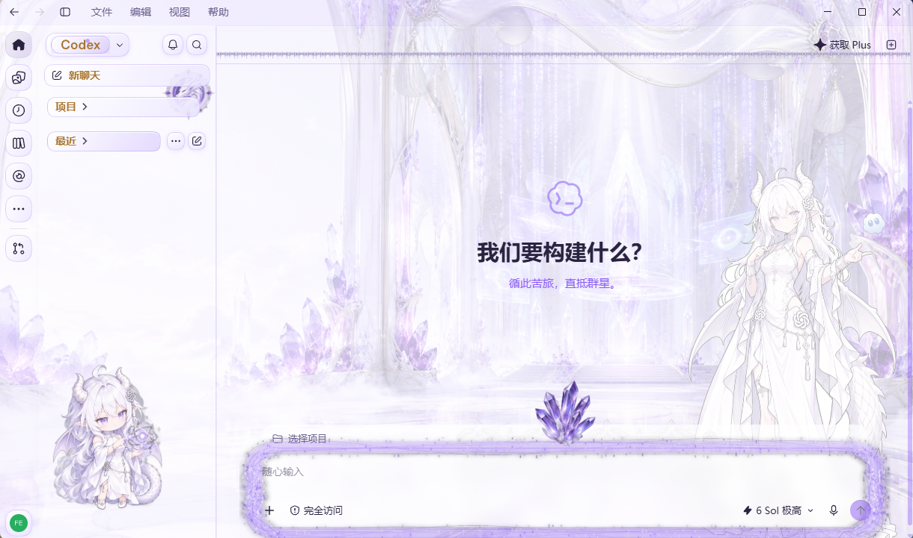

# 天空工坊 · Codex 皮肤

> **Sky Atelier** — 白 / 淡紫 / 紫水晶 · 01 数据流风格的 **Codex 桌面版**皮肤，主角是白色大肥龙 GPT-Niang。
> 基于 [Codex Dream Skin](https://dreamskin.cc) 引擎，本仓库提供**明 / 暗两套主题** + **一层引擎样式覆盖**。



> 截图中的项目名仅作展示。本仓库**不包含**任何第三方皮肤的素材，美术均为本项目自行生成。

---

## 特色

| 位置 | 效果 |
|---|---|
| 背景 | 白紫水晶宫殿（2560×1600，明 / 暗两版），右侧站立白色龙娘立绘 |
| 侧栏顶部 | 龙形纹章（72px），落在「新聊天 ↔ 项目」之间 |
| 侧栏底部 | Q 版龙娘（150px），沉在文字之下不挡操作 |
| 顶栏 | 底部一条冰晶花边（22px，`repeat-x`） |
| 输入框 | 「01 飘带流光」环绕在框**外圈** + 92px 晶簇水晶花压顶边 |
| Codex 标题 | 白紫渐变胶囊 + 烫金字 |
| 新聊天 / 项目 / 最近 | 金色胶囊行 + 金色文字 |
| 下拉菜单 / 模型托盘 | 24px 圆角白紫胶囊托盘 |
| 首页标题区 | 官方 logo 恢复并染紫、标题放大 `clamp(24px, 2.4vw, 32px)`、副标题删除 |
| tagline | 「循此苦旅，直抵群星。」紫色 15px |
| 项目名 chip | 去掉「选择项目 · 」前缀与胶囊框、点状下划线，只留加粗紫项目名 |
| 响应式 | 输入框光环高度用 `calc(100% - 76px)`，随窗口自适应不裁切 |

---

## 获取

```bash
git clone https://github.com/eleysia111/codex-skin-violet-dragon.git
cd codex-skin-violet-dragon
```

只想直接用皮肤的话，去 [Releases](https://github.com/eleysia111/codex-skin-violet-dragon/releases)
下载 `sky-atelier-codex-skin-v1.0.zip`——里面是「拿来就能用」的皮肤文件与校验脚本，
不含素材库与生成脚本（那部分要用仓库源码）。

---

## 环境要求

- **Windows 10 / 11**
- **Codex 桌面版**（MSIX 安装版；实测 `26.1013.4894.0`）
- **Codex Dream Skin** 引擎已安装并处于可用状态（本仓库**不包含**引擎本体）
- 若要重新生成素材或重建补丁：Python 3 + `Pillow`，Node.js

---

## 安装

### 1. 装主题（明 + 暗两套，明版激活）

```powershell
powershell -ExecutionPolicy Bypass -File .\apply-themes.ps1
```

它会把 `theme.json` / `background.png` 与 `theme-night.json` / `background-night.png` 装进 Dream Skin 的主题库，
并把明版设为当前主题。夜版可在托盘的主题管理里随时切换。

### 2. 打引擎样式覆盖（关键，决定「精修」是否生效）

```powershell
# 先看状态
powershell -ExecutionPolicy Bypass -File .\patch-engine-css.ps1 -Action status

# 打补丁（幂等，重复执行不会叠加）
powershell -ExecutionPolicy Bypass -File .\patch-engine-css.ps1 -Action apply
```

> 第一次 `apply` 会自动把**你自己的**引擎原始样式表备份到 `engine-backups\`，不会覆盖已有备份。

### 3. 完整重启 Codex

改动引擎样式表后**必须完整重启**才生效（页面内刷新不生效，原因见 [docs/TECHNICAL.md](docs/TECHNICAL.md)）。
推荐顺序：先从托盘退出 Codex，再用 Dream Skin 的启动入口重新打开。

### 4. 想退回去

```powershell
powershell -ExecutionPolicy Bypass -File .\patch-engine-css.ps1 -Action revert
```

### 5. 校验（可选，改过主题文件后建议跑）

```powershell
# 主题包校验：自动把明/暗两套整理成干净目录再验（官方 theme-package-validator 规则）
powershell -ExecutionPolicy Bypass -File .\tools\validate-package.ps1

# 安全 CSS 校验：需要传入 Dream Skin 引擎自带的校验器
node .\tools\validate_css.mjs `
  "$env:LOCALAPPDATA\CodexDreamSkin\engine\assets\safe-css-validator.mjs" `
  .\theme.css
```

> 注意 `validate_theme.py` 校验的是**主题包目录**，只允许 `theme.json` + 一张背景图（可选 `theme.css`），
> 目录里出现任何多余文件都会判失败 —— 所以别直接在仓库根目录跑它，用 `validate-package.ps1`。

---

## 目录结构

```
.
├─ theme.json / theme-night.json   明 / 暗主题配置
├─ theme.css                       主题包安全 CSS（描边、投影；Dream Skin 白名单内）
├─ background.png                  明版背景 2560×1600
├─ background-night.png            夜版背景 2560×1600
├─ apply-themes.ps1                把两套主题装进 Dream Skin
├─ patch-engine-css.ps1            引擎样式覆盖工具：status / apply / revert
├─ engine-patch.css                ⚙ 生成物：由 tools\build_engine_patch.py 产出
├─ validate_theme.py               主题包校验器（复刻官方 theme-package-validator 规则）
├─ patches\                        手工维护的覆盖块（apply 时注入到 END 标记之前）
│  ├─ 30-manual-blocks.css         菜单 / 分组标题 / 导航行胶囊
│  └─ 40-hero-fixes.css            首页文案修整（副标题、tagline、chip、logo、字号）
├─ assets-in\                      角色原图（立绘 / Q 版）
├─ assets-gen\image2\              gpt-image-2 生成的宫殿、流光带、花边、纹章、晶簇花
├─ docs\
│  ├─ TECHNICAL.md                 机制与踩坑（改样式前必读）
│  └─ screenshots\
└─ tools\                          生成 / 校验工具
   ├─ validate-package.ps1         主题包校验入口（已随发布包提供）
   ├─ validate_css.mjs             safe-css 校验（需传入引擎的 safe-css-validator.mjs）
   ├─ build_engine_patch.py        生成引擎补丁主干（立绘、Q 版、花边、纹章）
   ├─ gen_composer_ring.py         输入框飘带流光环 + 晶簇花
   ├─ gen_capsule_css.py           Codex 标题胶囊 + 侧栏按钮胶囊
   ├─ compose_codex_theme.py       合成主题背景
   ├─ gen_image2.mjs               调 gpt-image-2 生图
   └─ dev\                         调试探针与实时预览工具（见 TECHNICAL）
```

> **发布包 vs 仓库**：发布 ZIP 只含「拿来就能用」的皮肤文件 + 校验脚本；
> `assets-*`、生成脚本（重烤素材 / 重建补丁）需要完整的仓库源码。

---

## 改样式的工作流（推荐）

**不要**改 `engine-patch.css`（它是生成物，重建即被覆盖）。手写规则一律放 `patches\*.css`：

1. 在 `patches\40-hero-fixes.css`（或新建 `patches\50-xxx.css`）里改
2. `patch-engine-css.ps1 -Action apply`
3. 完整重启 Codex 查看

调样式阶段可以用 `tools\dev\cdp_live.mjs` **实时预览**，不必反复重启：

```powershell
# 把候选规则写进一个 css，注入到运行中的 Codex 并截图
node .\tools\dev\cdp_live.mjs --css .\candidate.css --wait 400 --shot preview.png
```

重建整条补丁链（会重写 `engine-patch.css`，但 `patches\` 里的手写块不会丢）：

```powershell
python .\tools\build_engine_patch.py
python .\tools\gen_composer_ring.py
python .\tools\gen_capsule_css.py
powershell -ExecutionPolicy Bypass -File .\patch-engine-css.ps1 -Action apply
```

---

## 注意事项

- **Dream Skin 升级 / 重装会覆盖引擎样式表**，皮肤会「退回」未精修的样子。补丁文件不会丢，重跑一次 `-Action apply` 即可。
- **不要用页面刷新（F5 / `Page.reload`）来刷皮肤**：注入器对每个页面只注入一次，刷新会让皮肤直接消失。
- 改 `.ps1` 脚本请存成 **UTF-8 带 BOM**，否则 PowerShell 5.1 会按 GBK 读中文。
- `theme.css` 只能做描边、投影这类安全样式（引擎白名单限制）；要画背景/伪元素必须走 `patch-engine-css.ps1` 这条路。

更细的机制、层叠关系、DOM 节点表和踩过的坑都在 [docs/TECHNICAL.md](docs/TECHNICAL.md)。

---

## 许可

- **代码**（`.py` / `.mjs` / `.ps1`）：[MIT](LICENSE)
- **美术素材**（背景、立绘、生成件、截图）：[CC BY-NC-SA 4.0](LICENSE-ARTWORK.md) —— **禁止商用**，署名，衍生需同协议
- **不包含** Codex Dream Skin 引擎本体与任何第三方皮肤素材，详见 [NOTICE.md](NOTICE.md)

## 致谢

- [Codex Dream Skin](https://dreamskin.cc) —— 皮肤引擎与注入机制
- 风格参考 `@smalltailqwq/dsh-client-ui-skin-maid-atelier`（CC BY-NC-SA 4.0）：**仅参考配色思路与构图**，未使用其任何图片素材
- 素材生成：`gpt-image-2`
